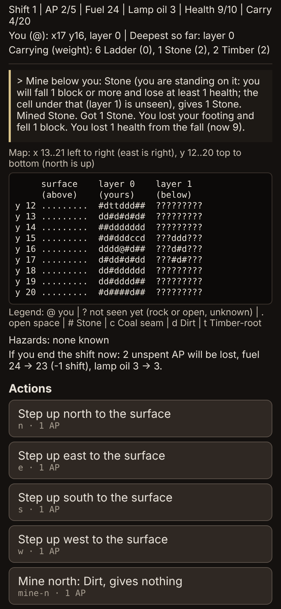

# Playing the early preview on a phone

The early preview (issue #64) is a plain tap screen for the game as it stands on `main`: the same view as `npm run play`, with one button per choice. It is throwaway; M3 replaces it. You can play it two ways.

## In the phone's browser

Open the repository's GitHub Pages address: on GitHub, go to the repository's **Settings → Pages**, where it is shown under "Your site is live at". Nothing to install. It updates every time `main` changes.

## As an Android app

The app is a "debug" build: Android installs it like any app, but it is not from the Play Store, so the phone asks you to allow it once.

### Download it

1. On the phone, open **https://github.com/dachhack/mining/releases/tag/android-preview** (the "Android preview" pre-release).
2. Under **Assets**, tap **mining-game-preview.apk**. The browser downloads it.

The release is rebuilt every time `main` changes, so this link always has the newest build. (Each build is also kept for 30 days as an artifact of the "Android preview" workflow run on the Actions tab, but artifacts download as a zip, which a phone cannot install directly.)

### Install it

1. Open the downloaded file (from the browser's downloads, or the notification).
2. The first time, Android says that for your safety the phone is not allowed to install unknown apps from this source. Tap **Settings**, turn on **Allow from this source** for the browser you used, and go back.
3. Tap **Install**. Google Play Protect may warn that it does not recognise the app; choose **Install anyway** (the wording varies by phone).
4. Open **Mining Game** from the app drawer.

You can turn "Allow from this source" off again afterwards; it is only needed while installing.

### Update it

Download the APK again from the same link and install it over the old one. Your saved run is kept. If the game's rules have changed since you saved it, the app says so when it resumes the run, because it is replayed under the new rules and may not be exactly where you left it; if it no longer replays at all, the app says so and starts a new run.

Every preview build is signed with the same key, so a new one installs over the old one. That key (`android/app/debug-preview.keystore`, the standard Android debug settings: alias `androiddebugkey`, password `android`) is public on purpose: it is for this debug preview only and is never used for the Play Store. The Play builds in M4 use a separate, secret upload key.

If Android ever refuses with "App not installed" or a "conflicting package" message (for example over a copy you built yourself on another machine, which is signed with that machine's own debug key), uninstall Mining Game first and install again. The saved run is lost on uninstall.

## Playing

- The gauges stay at the top. Below them: what came of your last choice, the map (your layer and the ones above and below; the legend under it explains the characters), the hazards, and what ending the shift now would do.
- Each button is one choice, with its play-tool name and its AP cost in small print. "End the shift" is last.
- The run is saved on the phone after every choice and resumed when you open the game again.
- **Restart** plays the same seed again from the start. **New run** asks for a seed (a random one is filled in); the same seed always makes the same cube.
