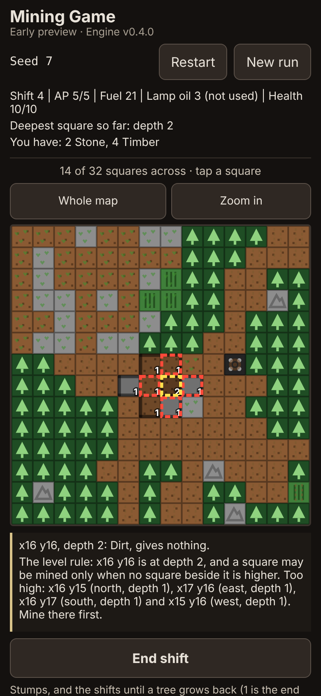

# Playing the early preview on a phone

The early preview (issues #64, #66 and #86) is a plain tap screen for the game as it stands on `main`: the same information as `npm run play`, with a coloured top-down map you can drag, pinch and tap. It is throwaway; M3 replaces it. You can play it two ways.

## In the phone's browser

Open the repository's GitHub Pages address: on GitHub, go to the repository's **Settings → Pages**, where it is shown under "Your site is live at". Nothing to install. It updates every time `main` changes.

## As an Android app

The app is a "debug" build: Android installs it like any app, but it is not from the Play Store, so the phone asks you to allow it once.

### Download it

1. On the phone, open **https://github.com/dachhack/mining/releases/tag/android-preview** (the "Android preview" pre-release).
2. Under **Assets**, tap **mining-game-preview.apk**. The browser downloads it.

The release is rebuilt every time `main` changes, so this link always has the newest build. (Each build is also kept for 30 days as an artifact of the "Android preview" workflow run on the Actions tab, but artifacts download as a zip, which a phone cannot install directly.)

### Install it

1. Open the downloaded file (from the browser's downloads, or the notification).
2. The first time, Android says that for your safety the phone is not allowed to install unknown apps from this source. Tap **Settings**, turn on **Allow from this source** for the browser you used, and go back.
3. Tap **Install**. Google Play Protect may warn that it does not recognise the app; choose **Install anyway** (the wording varies by phone).
4. Open **Mining Game** from the app drawer.

You can turn "Allow from this source" off again afterwards; it is only needed while installing.

### Update it

Download the APK again from the same link and install it over the old one. Your saved run is kept. If the game's rules have changed since you saved it, the app says so when it resumes the run, because it is replayed under the new rules and may not be exactly where you left it; if it no longer replays at all, the app says so and starts a new run.

Every preview build is signed with the same key, so a new one installs over the old one. That key (`android/app/debug-preview.keystore`, the standard Android debug settings: alias `androiddebugkey`, password `android`) is public on purpose: it is for this debug preview only and is never used for the Play Store. The Play builds in M4 use a separate, secret upload key.

If Android ever refuses with "App not installed" or a "conflicting package" message (for example over a copy you built yourself on another machine, which is signed with that machine's own debug key), uninstall Mining Game first and install again. The saved run is lost on uninstall.

## Playing

There is no miner. You look down on the whole surface and tap squares (design doc v0.2; issue #86).

- The gauges stay at the top. Below them: the map, then what came of your last tap, then **End shift**.
- **The map** is the whole 32 × 32 surface from above. Each square shows its top block as a coloured, patterned tile; the legend at the bottom of the page names what is on screen. A square you have dug is **darker the deeper it is**, shows its depth as a number, and has a shadow along each side where the square beside it is higher, so the terraces of a pit read at a glance. Trees are solid dark green and hide the block under them. Stumps, dirt paths, meadows and stone outcrops are faint marks over the block. Gold dots are mineral traces. There are no layers: only the top level is ever shown.
- **Tap a square** and it happens at once; there is no menu. A tap on a tree cuts it (2 AP, 2 timber; the block under it then shows). A tap on any other square mines its top block, wherever it is on the map.
- **A tap the rules refuse** changes nothing. The reason appears under the map, with the square's depth and block, and the square gets a yellow dashed outline. If it is the level rule (a square may be mined only when no square beside it is higher), the squares that are too high get **red dashed outlines**: mine those first. Too little AP is also said there. The outlines go at your next tap or choice.
- **Zoom.** The map starts on its middle, showing 14 squares across, so each square is big enough to tap. **Pinch** with two fingers to zoom, from 8 squares across out to all 32; on a computer the mouse wheel does the same. **Whole map** shows everything at once (squares are then about 11 px on a phone: good for looking, fiddly for tapping), and **Zoom in** goes back to 14 across. The phone remembers your zoom.
- **Drag** the map to look around. A drag or a pinch is never taken for a tap.
- **End shift** is the wide button under the map. Crafting and leaving are in **Other actions** below it; leaving asks first, because it ends the run.
- No tap needs a second tap any more. The double tap of earlier builds guarded a fall, and then a yield too heavy to carry; there are no falls, and the carry limit is not enforced (decision note 0026).
- The run is saved on the phone after every choice and resumed when you open the game again. A run saved by a build from before mining by square cannot be replayed: the app says so once and starts a new run.
- **Restart** plays the same seed again from the start. **New run** asks for a seed (a random one is filled in); the same seed always makes the same cube.
