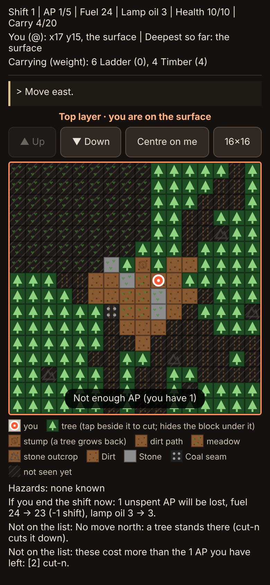

# Playing the early preview on a phone

The early preview (issues #64 and #66) is a plain tap screen for the game as it stands on `main`: the same information as `npm run play`, with a coloured map you can drag and tap. It is throwaway; M3 replaces it. You can play it two ways.

## In the phone's browser

Open the repository's GitHub Pages address: on GitHub, go to the repository's **Settings → Pages**, where it is shown under "Your site is live at". Nothing to install. It updates every time `main` changes.

## As an Android app

The app is a "debug" build: Android installs it like any app, but it is not from the Play Store, so the phone asks you to allow it once.

### Download it

1. On the phone, open **https://github.com/dachhack/mining/releases/tag/android-preview** (the "Android preview" pre-release).
2. Under **Assets**, tap **mining-game-preview.apk**. The browser downloads it.

The release is rebuilt every time `main` changes, so this link always has the newest build. (Each build is also kept for 30 days as an artifact of the "Android preview" workflow run on the Actions tab, but artifacts download as a zip, which a phone cannot install directly.)

### Install it

1. Open the downloaded file (from the browser's downloads, or the notification).
2. The first time, Android says that for your safety the phone is not allowed to install unknown apps from this source. Tap **Settings**, turn on **Allow from this source** for the browser you used, and go back.
3. Tap **Install**. Google Play Protect may warn that it does not recognise the app; choose **Install anyway** (the wording varies by phone).
4. Open **Mining Game** from the app drawer.

You can turn "Allow from this source" off again afterwards; it is only needed while installing.

### Update it

Download the APK again from the same link and install it over the old one. Your saved run is kept. If the game's rules have changed since you saved it, the app says so when it resumes the run, because it is replayed under the new rules and may not be exactly where you left it; if it no longer replays at all, the app says so and starts a new run.

Every preview build is signed with the same key, so a new one installs over the old one. That key (`android/app/debug-preview.keystore`, the standard Android debug settings: alias `androiddebugkey`, password `android`) is public on purpose: it is for this debug preview only and is never used for the Play Store. The Play builds in M4 use a separate, secret upload key.

If Android ever refuses with "App not installed" or a "conflicting package" message (for example over a copy you built yourself on another machine, which is signed with that machine's own debug key), uninstall Mining Game first and install again. The saved run is lost on uninstall.

## Playing

- The gauges stay at the top. Below them: what came of your last choice, then the map.
- **The map** shows 16 × 16 cells of one layer as coloured tiles; the legend under it names what is on screen. Cells you have not seen are dark with diagonal lines (they never show what is really there). Cells you have seen but that are not in light now are drawn darker. Each kind of rock has a pattern as well as a colour. Marks on top: you (a red disc with a white ring), ladders, torches, loose items (a small white diamond), and gold dots for mineral traces.
- **The top view.** A run starts on the top layer, with the surface drawn on it: trees (solid dark green; they hide the block under them), and over the blocks you can see, the faint marks of stumps, dirt paths, meadows and stone outcrops. You are drawn on it while you walk on the surface. There is no separate surface layer.
- **Pinch** with two fingers to zoom: from 8 × 8 cells (big tiles, easy to tap) out to the whole 32 × 32 layer. On a computer the mouse wheel does the same. **16×16** goes back to the usual size, and the phone remembers your zoom.
- **Drag** the map to look around. **Centre on me** brings it back to you. **▼ Down** and **▲ Up** show the layers below the top view (the label says which layer, and the map's border is orange on your own layer).
- **Tap a cell** and it happens at once, as in Minecraft; there is no menu. Tap a block beside you to break it, an open cell beside you to walk into it, a tree beside you to cut it (the block under it then shows), and yourself to dig down. Your pick reaches only the blocks beside you (north, east, south, west) and the one you stand on. If a cell offers more than one thing, a tap breaks or cuts first, else walks, else picks up; the rest is in the full list. Digging down onto rock is a safe one-block drop; the line above the map then says what happened.
- **Risky taps need a second tap.** If a tap would make you fall or drop, or leave a yield behind because it is too heavy to carry, the first tap only marks the cell (a yellow dashed outline) and says why ("Tap again to go there: you will drop 1 block to layer 0"). Tap the same cell again within three seconds to do it; tap anywhere else to cancel.
- A tap with nothing to do says "Nothing to do there", or "Not enough AP" when the cell would have something with more AP.
- Everything else (crafting, placing ladders and torches, dropping, leaving, ending the shift) is in **All actions** under the map: tap it to unfold the full list.
- The run is saved on the phone after every choice and resumed when you open the game again.
- **Restart** plays the same seed again from the start. **New run** asks for a seed (a random one is filled in); the same seed always makes the same cube.
